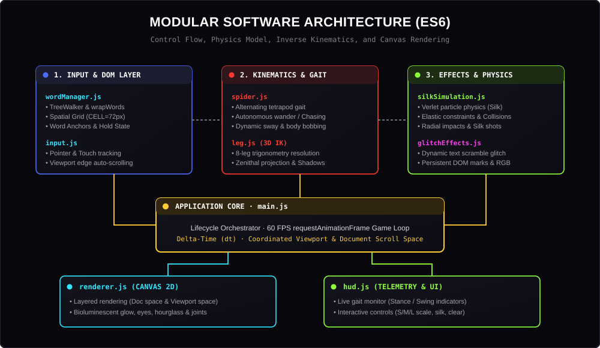
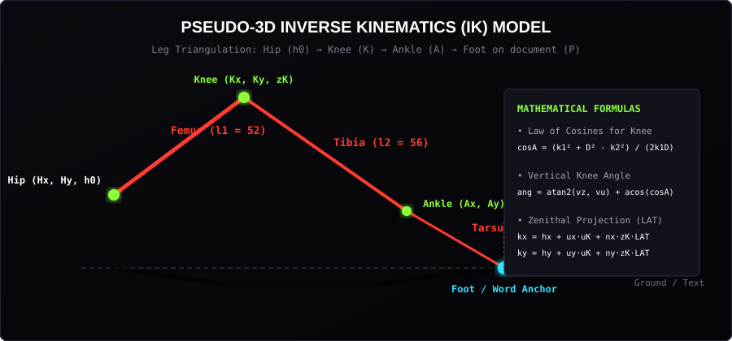
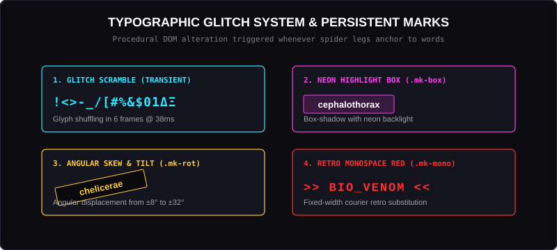
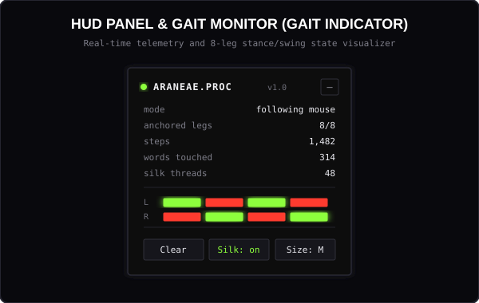

<p align="center">
  
</p>

<p align="center">
  
  
  
  
  
  

---

## 🕷️ Resumen del Proyecto

**Arachnopedia (`Araneae.proc`)** es una experiencia web interactiva de alto impacto visual que combina una enciclopedia enciclopédica temática sobre arañas con una **simulación biológica y física procedural en tiempo real**.

Una araña biomecánica inteligente de 8 patas recorre el artículo, detecta cada palabra del texto en el DOM mediante una rejilla espacial optimizada (*Spatial Hashing*), calcula el movimiento natural de sus extremidades mediante **Cinemática Inversa pseudo-3D (IK)**, deja marcas de glitch cibernético a su paso y teje redes de hilos elásticos simulados mediante **física de Verlet**.

---

## 🎬 Demostración Visual e Interacción

> [!TIP]
> **Espacio Visual para Imágenes / Videos del Usuario**:  
> A continuación se presenta el área principal de previsualización. Puedes colocar tu propio video (`.mp4`, `.webm`) o animación GIF (`demo.gif`) directamente dentro de la carpeta [`images/`](images/) para que se exhiba aquí.

<p align="center">
  <!-- Si cargas tu demo.gif en la carpeta images/, se mostrará automáticamente aquí -->
  
</p>

<p align="center">
  <em>💡 ¿Deseas incrustar un video MP4 en lugar de un GIF? Simplemente añade <code>&lt;video src="images/demo.mp4" width="90%" autoplay loop muted playsinline controls&gt;&lt;/video&gt;</code>.</em>
</p>

---

## 🌟 Características Principales

```
 ┌────────────────────────────────────────────────────────────────────────┐
 │                           ARANEAE.PROC ENGINE                          │
 ├───────────────────┬───────────────────┬────────────────────────────────┤
 │ 🦵 Cinemática IK  │ 🕸️ Física Seda    │ ⚡ Glitch Tipográfico          │
 │ 8 patas 3D reales │ Cuerdas de Verlet │ Scramble en 6 fotogramas       │
 │ Marcha tetrápoda  │ Tensión elástica  │ Aberración cromática RGB       │
 │ Sombras dinámicas │ Disparo por clic  │ Anclajes '.held' sobre el DOM  │
 └───────────────────┴───────────────────┴────────────────────────────────┘
```

1. **Cinemática Inversa Pseudo-3D (IK)**:
   - Cada pata se resuelve trigonométricamente calculando ángulos reales para cadera, fémur, tibia y tarso.
   - Proyección cenital con curvatura vertical ($LAT = 0.45$) y sombras proyectadas en el sustrato según vector de luz.
   - Articulaciones bioluminiscentes verdes neón con halo de desenfoque (*glow*).

2. **Marcha Tetrápoda Alterna (Gait Controller)**:
   - Emulación biológica de la locomoción de artrópodos: alterna dos grupos de 4 patas ($I1, D2, I3, D4$ vs $D1, I2, D3, I4$) para mantener el polígono de sustentación.
   - Detección de urgencia de paso ante giros bruscos, cruce de patas o sobreextensión articular.
   - Micro-golpeteos sensoriales (*taps*) de las patas delanteras durante el estado de reposo.

3. **Indexación Espacial y Anclaje al DOM (Spatial Grid)**:
   - El motor descompone el texto del artículo en `<span class="w">` sin alterar el flujo tipográfico ni los saltos de línea.
   - Rejilla espacial en memoria (`CELL = 72px`) que permite consultas en tiempo constante $O(1)$ para hallar la palabra más cercana a cada extremidad.

4. **Simulación de Seda con Integración de Verlet**:
   - Hilos elásticos continuos sujetos a gravedad ($g$), resistencia elástica, relajación en 6 iteraciones y deformación por colisión con el cuerpo de la araña.
   - Disparo teledirigido de hilos con clic sobre palabras y tendido de hilo de seguridad (*dragline*) tras el abdomen.

5. **Glitch Cibernético y Marcas Persistentes**:
   - Efecto *scramble* progresivo con glifos cibernéticos (`!<>-_/[]{}=+*^?#%&$@|~:;01ΔΞΣΨ`).
   - Marcas tipográficas aleatorias: cajas neón, inversión cromática, rotaciones angulares, sustitución monospace retro y ampliaciones tipográficas.

6. **Desplazamiento Cinemático en Bordes (Edge Auto-Scroll)**:
   - Cuando el cursor y la araña alcanzan el margen superior o inferior, la página se desplaza fluidamente adaptando la velocidad a la proximidad del borde.

7. **Telemetría en Vivo y Panel HUD**:
   - Monitor de marcha con 8 indicadores luminosos que reflejan en tiempo real qué patas están apoyadas (verde) o en el aire dando un paso (rojo).
   - Contadores de pasos acumulados, palabras intervenidas, hilos activos y conmutadores de tamaño ($S, M, L$) y activación de seda.

---

## 🏛️ Arquitectura del Proyecto

El código ha sido reestructurado desde un script monolítico hacia una **arquitectura modular moderna basada en ES6 Modules y CSS desacoplado**:

<p align="center">
  
</p>

### 📁 Estructura de Directorios

```tree
Araña_Proyect/
│
├── index.html                 # Página principal interactiva (Arachnopedia)
├── package.json               # Configuración de scripts y comandos de desarrollo
├── styles.css                 # Entrada retrocompatible de estilos (@import ./css/main.css)
├── script.js                  # Versión autónoma retrocompatible y fallback para file://
│
├── css/                       # Arquitectura de estilos modular
│   ├── main.css               # Ensamblador principal de hojas de estilo
│   ├── variables.css          # Paleta de colores, variables y tokens de diseño
│   ├── base.css               # Resets globales, tipografía y enlaces
│   ├── article.css            # Maquetación enciclopédica, infobox y referencias
│   ├── glitch.css             # Estilos de palabras interactivas, scramble y marcas DOM
│   ├── canvas.css             # Posicionamiento y dimensiones fijas del lienzo
│   └── hud.css                # Panel de telemetría, visor de paso y controles
│
├── js/                        # Arquitectura JavaScript modular (ES6 Modules)
│   ├── main.js                # Orquestador central, ciclo de vida y bucle a 60 FPS
│   ├── config/
│   │   └── constants.js       # Constantes matemáticas, colores, geometría y parámetros
│   ├── utils/
│   │   └── math.js            # Funciones de interpolación, easing y números aleatorios
│   ├── core/
│   │   ├── wordManager.js     # Envoltura del DOM, rejilla espacial (Spatial Grid) y anclajes
│   │   └── input.js           # Puntero, touch, clic de disparos y auto-scroll de bordes
│   ├── entities/
│   │   ├── leg.js             # Definición anatómica de 8 patas e Cinemática Inversa (IK 3D)
│   │   └── spider.js          # Estado de la araña, marcha tetrápoda, navegación y balanceo
│   ├── effects/
│   │   ├── silkSimulation.js  # Física de Verlet, hilos, impactos, capullos y disparos
│   │   └── glitchEffects.js   # Scramble tipográfico, sacudida DOM y marcas permanentes
│   ├── rendering/
│   │   └── renderer.js        # Motor Canvas 2D: cuerpo, articulaciones, sombras y seda
│   └── ui/
│       └── hud.js             # Controlador del panel HUD y monitor de marcha
│
└── images/                    # Recursos visuales, capturas, diagramas y videos
    ├── README.md              # Guía de especificaciones para subir imágenes y videos
    ├── hero-banner.svg        # Banner gráfico principal
    ├── demo-preview.svg       # Tarjeta gráfica de previsualización
    ├── architecture-diagram.svg # Diagrama de arquitectura del software
    ├── kinematics-diagram.svg # Diagrama matemático de la cinemática inversa
    ├── hud-telemetry.svg      # Vista previa del HUD y monitor de marcha
    └── glitch-preview.svg     # Muestra de efectos de glitch y marcas
```

---

## 🔬 Funcionamiento Técnico Detallado

### 1. Cinemática Inversa (IK) en 3D
Cada una de las 8 extremidades cuenta con articulaciones en planos locales:
- **Cadera ($H$)**: Conectada al prosoma con un offset angular específico.
- **Fémur ($l_1$) y Tibia ($l_2$)**: Resueltos mediante la ley de cosenos en el triángulo de elevación vertical.
- **Tarso ($l_3$)**: Apunta en descenso oblicuo hacia el pie.
- **Pie ($P$)**: Se proyecta lateralmente con un arco paramétrico ($LAT = 0.45$) y se eleva verticalmente con una parábola seno durante el paso.

<p align="center">
  
</p>

### 2. Física de Verlet en Hilos de Seda
Cada hilo está discretizado en $n$ partículas conectadas ($P_0 \dots P_n$):
1. **Paso temporal**: $p_x \leftarrow p_x + v_x \cdot 0.982$, $p_y \leftarrow p_y + v_y \cdot 0.982 + g$.
2. **Repulsión biomecánica**: Si una partícula se acerca al radio del cuerpo ($R = 34 \cdot scale$), es empujada hacia fuera simulando el paso del arácnido sobre la red.
3. **Restricción elástica**: 6 iteraciones de relajación garantizan que ningún segmento supere su distancia de reposo.

### 3. Sistema de Glitch Tipográfico y Marcas
Cuando una pata pisa una palabra, activa una animación de desencadenamiento:

<p align="center">
  
</p>

- **Fase 1 (Inmediata)**: Sacudida con CSS `animate` y reemplazo momentáneo por glifos aleatorios en 6 fases a 38 ms.
- **Fase 2 (Persistente)**: Probabilidad de fijar una marca de mutación visual (`mk-box`, `mk-inv`, `mk-rot`, `mk-mono`, `mk-big`, `mk-red`) con temporizador de expiración orgánica entre 6.5s y 12s.
- **Fase 3 (Envoltura)**: Si la seda está activa, se teje un capullo de líneas blancas sobre la palabra.

### 4. Telemetría y Controles HUD

<p align="center">
  
</p>

- **Monitor de Marcha**: Las 4 patas izquierdas ($I$) y 4 derechas ($D$) encienden un indicador verde neón cuando están apoyadas (*stance*) o rojo cuando avanzan en el aire (*swing*).
- **Botón "Limpiar"**: Restaura instantáneamente todas las palabras mutadas y desintegra los hilos de seda.
- **Botón "Seda"**: Activa o desactiva la expulsión de hilo de arrastre y disparos.
- **Botón "Tamaño"**: Conmuta entre tamaños **S** ($0.75\times$), **M** ($1.0\times$) y **L** ($1.4\times$).
- **Botón "– / +"**: Pliega o despliega el panel HUD en pantalla.

---

## 🚀 Cómo Ejecutar el Proyecto

El proyecto está diseñado para funcionar tanto con servidores web locales modernos como de forma directa en cualquier navegador:

### Opción 1: Servidor Local con Node / Python (Recomendado)

Al usar módulos nativos de ES6 (`import` / `export`), la forma óptima de ejecución es mediante un servidor HTTP local:

```bash
# Con npm (utiliza python3 internamente):
npm start

# O directamente con Python 3:
python3 -m http.server 3000

# O utilizando npx serve:
npx serve .
```

Abre tu navegador en: **`http://localhost:3000`**

### Opción 2: VS Code / Live Server
1. Abre la carpeta del proyecto en VS Code o tu editor preferido.
2. Haz clic derecho sobre `index.html` y selecciona **"Open with Live Server"**.

### Opción 3: Apertura Directa en Navegador (`file://`)
Gracias al sistema de **fallback inteligente** integrado en `index.html`, si abres el archivo directamente con doble clic en tu explorador de archivos, el sistema detecta si el protocolo local restringe los módulos ES6 y activa de forma transparente la versión autónoma de respaldo sin que tengas que configurar nada.

---

## 🎨 Personalización Rápida

| Parámetro | Archivo | Efecto |
| :--- | :--- | :--- |
| **Colores y Estética** | [`css/variables.css`](css/variables.css) | Modifica `--leg` (color de patas), `--joint` (articulaciones neón) o `--cyan`/`--mag` (glitch). |
| **Dimensiones de la Araña** | [`js/config/constants.js`](js/config/constants.js) | Ajusta `SIZES` para cambiar las escalas disponibles o `LEGDEF` para modificar la longitud de los segmentos. |
| **Física de la Seda** | [`js/effects/silkSimulation.js`](js/effects/silkSimulation.js) | Altera `g` para regular la caída por gravedad o las iteraciones de relajación de tensión. |
| **Sensibilidad de Scroll** | [`js/config/constants.js`](js/config/constants.js) | Configura `EDGE_ZONE` y `EDGE_MAX_SPEED` para calibrar el auto-desplazamiento en bordes. |

---

## 📄 Licencia

Este proyecto está distribuido bajo la licencia **MIT**. Eres libre de utilizarlo, modificarlo y compartirlo para proyectos personales, educativos o comerciales.
