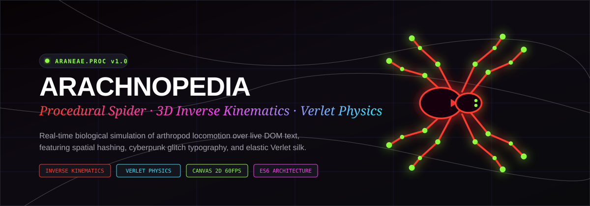

<p align="center">
  
</p>

<p align="center">
  <a href="#-quick-start"></a>
  <a href="#-architecture"></a>
  <a href="#-features"></a>
  <a href="#-features"></a>
  <a href="#-quick-start"></a>
  <a href="#-license"></a>
</p>

---

## 🕷️ Overview

**Arachnopedia (`Araneae.proc`)** is an interactive web experiment combining an encyclopedic article about spiders with a **real-time procedural biological simulation**.

A biomechanical spider navigates the page, indexing live DOM words via a **Spatial Hashing Grid**, anchoring its 8 limbs with **3D Inverse Kinematics (IK)**, leaving cyberpunk glitch traces, and weaving elastic silk threads driven by **Verlet physics**.

---


## ✨ Key Features

- **🦵 Pseudo-3D Inverse Kinematics (IK)**: Trigonometric resolution for all 8 legs (hip, femur, tibia, tarsus), directional ground shadows, and bioluminescent glowing joints.
- **🕷️ Alternating Tetrapod Gait**: Natural arthropod locomotion alternating two groups of 4 legs ($I1, D2, I3, D4$ vs. $D1, I2, D3, I4$) with urgency override and idle sensory taps.
- **📄 DOM Text Anchoring & Spatial Grid**: Parses text into `<span class="w">` and indexes words into a 72px spatial hash grid for instantaneous $O(1)$ leg targeting without layout reflows.
- **🕸️ Verlet Silk Physics**: Elastic silk lines with gravity ($g$), constraint relaxation, spider body repulsion, click-to-shoot web targeting, and safety draglines.
- **⚡ Cyberpunk Glitch Typography**: Real-time glyph scrambling (`!<>-_/[]{}=+*^?#%&$@|~:;01ΔΞΣΨ`), chromatic aberration, and persistent DOM style mutations.
- **📊 Live Telemetry HUD**: Real-time monitor with 8 stance/swing gait lights, step counter, word counter, active thread stats, and scale toggles.
- **🖱️ Viewport Edge Auto-Scroll**: Kinetic page scrolling when following the cursor near the top or bottom edges.

---

## 🏛️ Architecture & Project Structure

<p align="center">
  
</p>

```tree
Araña_Proyect/
│
├── index.html                 # Main HTML application & dual script loader
├── package.json               # Project scripts (npm start, syntax test)
├── styles.css                 # Backward-compatible CSS entry point
├── script.js                  # Standalone fallback engine (for direct file:// runs)
│
├── css/                       # Modular Stylesheets
│   ├── main.css               # CSS aggregator
│   ├── variables.css          # Design tokens & palette
│   ├── base.css               # Typography & resets
│   ├── article.css            # Encyclopedic layout & infobox
│   ├── glitch.css             # Text glitch & persistent marks
│   ├── canvas.css             # Fixed viewport canvas
│   └── hud.css                # Telemetry HUD & gait visualizer
│
├── js/                        # Modular JavaScript (ES6 Modules)
│   ├── main.js                # App orchestrator & 60 FPS game loop
│   ├── config/constants.js    # Geometric, anatomical & physical parameters
│   ├── utils/math.js          # Easing, lerp, clamp & random utilities
│   ├── core/wordManager.js    # DOM tree walker & 72px spatial grid
│   ├── core/input.js          # Pointer, touch & edge auto-scroll
│   ├── entities/leg.js        # 8-legged 3D Inverse Kinematics (IK)
│   ├── entities/spider.js     # Spider state, gait controller & dragline
│   ├── effects/silkSimulation.js # Verlet physics & elastic silk threads
│   ├── effects/glitchEffects.js  # Text scramble & DOM marks
│   ├── rendering/renderer.js  # Canvas 2D multi-layer renderer
│   └── ui/hud.js              # HUD controller & gait indicator
│
└── images/                    # Visual assets, diagrams & demo showcase
    ├── README.md              # Image/video placement specifications
    ├── hero-banner.svg        # Hero header banner
    ├── demo-preview.svg       # Demo card preview
    ├── architecture-diagram.svg # Architecture diagram
    ├── kinematics-diagram.svg # 3D IK mathematical model
    ├── hud-telemetry.svg      # HUD telemetry preview
    └── glitch-preview.svg     # Glitch typography preview
```

---

## 🔬 How It Works

<p align="center">
  
</p>

<details>
<summary><b>📐 1. Inverse Kinematics (IK) & Gait</b> (Click to expand)</summary>
<br>

- **Leg Resolution**: The distance $D$ from hip $(hx, hy, h0)$ to ankle $(uA, zA)$ is triangulated using the **Law of Cosines** to calculate the knee position $(Kx, Ky, zK)$.
- **Zenithal Projection**: Height is projected horizontally with lateral bowing ($LAT = 0.45$), casting directional ground shadows $(LIGHT\_X, LIGHT\_Y)$.
- **Gait Timing**: Steps transition with $easeInOut$ curves, alternating support polygons to maintain continuous equilibrium.
</details>

<details>
<summary><b>🕸️ 2. Verlet Silk & Glitch Engine</b> (Click to expand)</summary>
<br>

- **Verlet Integration**: Each silk line consists of discrete points relaxed 6 times per frame: $p \leftarrow p + v \cdot 0.982 + g$.
- **Glitch Scramble**: Words step through 6 decoding frames at 38ms intervals, triggering temporary CSS 3D skew animations and persistent neon badges.
</details>

---

## 🚀 Quick Start

Run the project locally with any static HTTP server or open it directly:

```bash
# Clone the repository
git clone https://github.com/your-username/araneae-proc.git
cd araneae-proc

# Option A: Start with npm (Python or Node)
npm start

# Option B: Run directly with Python
python3 -m http.server 3000

# Option C: Run with npx serve
npx serve .
```

Open **`http://localhost:3000`** in your browser.

> [!NOTE]
> **Direct Double-Click (`file://`) Support**:  
> `index.html` includes an automated dual-loader. If opened directly via `file://` (where Chromium blocks ES modules due to local CORS policies), it seamlessly switches to the standalone engine without requiring server setup.

---

## 🎮 Controls

| Action | Control | Description |
| :--- | :--- | :--- |
| **Follow Mouse** | Move pointer | The spider tracks the cursor with smooth damping and body sway. |
| **Wander Mode** | Leave idle | The spider autonomously explores the article and taps resting words. |
| **Shoot Silk** | Click on any word | Launches a targeted silk thread and triggers a localized glitch. |
| **Auto-Scroll** | Guide to top/bottom | Automatically scrolls the page when the spider reaches the margins. |
| **Clear** | HUD Button | Clears all active silk threads and resets glitched words. |
| **Toggle Silk** | HUD Button | Enables / disables silk extrusion and safety draglines. |
| **Cycle Size** | HUD Button | Cycles spider scale between **S** ($0.75\times$), **M** ($1.0\times$), and **L** ($1.4\times$). |
| **Minimize** | HUD `– / +` | Expands or collapses the HUD telemetry panel. |

---

## 📄 License

Distributed under the **MIT License**. Feel free to use, modify, and distribute for personal, educational, or commercial projects.